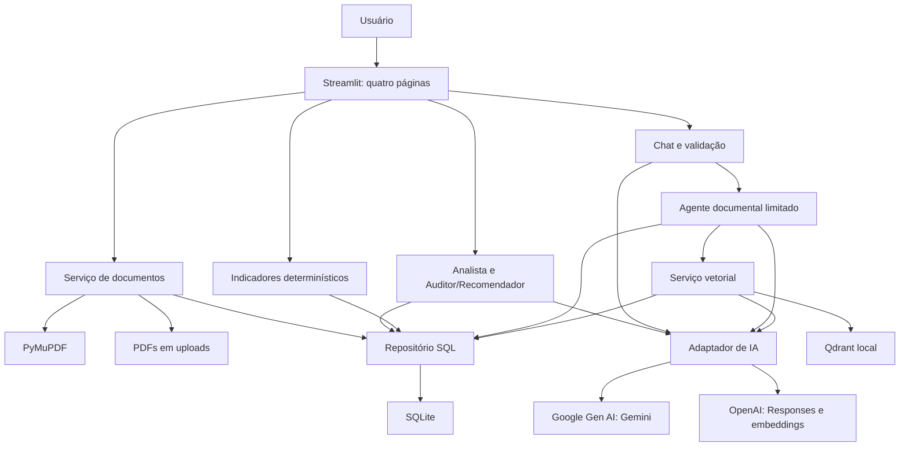
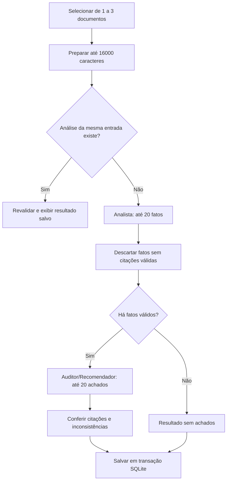
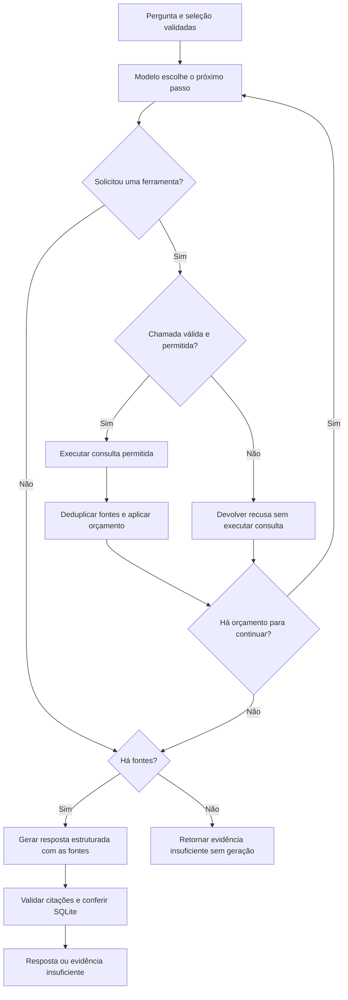
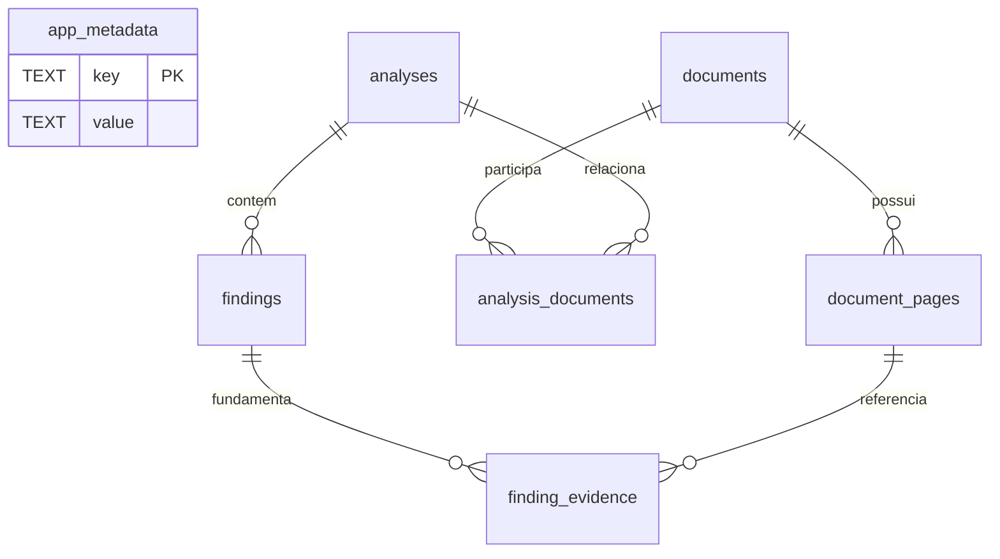

# InsightFlow AI

Plataforma local de inteligência documental para organizar PDFs, extrair texto, identificar obrigações e prazos, sugerir possíveis riscos e consultar documentos com um agente de IA e fontes verificáveis.

MVP para hackathon em Python e Streamlit, com SQLite como origem dos dados, Qdrant local para recuperação semântica e Gemini ou OpenAI para análise, geração e embeddings. Os resultados apoiam a revisão humana; não constituem auditoria conclusiva ou parecer jurídico

## Sumário

- [Funcionalidades e modos](#funcionalidades-e-modos)
- [Instalação e execução](#instalação-e-execução)
- [Configuração completa](#configuração-completa)
- [Arquitetura e stack](#arquitetura-e-stack)
- [Estrutura do repositório](#estrutura-do-repositório)
- [Processamento de PDFs](#processamento-de-pdfs)
- [Agentes e análise documental](#agentes-e-análise-documental)
- [Agente de investigação no chat](#agente-de-investigação-no-chat)
- [RAG e Qdrant local](#rag-e-qdrant-local)
- [Integração com Gemini e OpenAI](#integração-com-gemini-e-openai)
- [Schemas e validação das fontes](#schemas-e-validação-das-fontes)
- [Banco de dados e persistência](#banco-de-dados-e-persistência)
- [Dashboard e indicadores](#dashboard-e-indicadores)
- [Limites técnicos e custos](#limites-técnicos-e-custos)
- [Segurança e privacidade](#segurança-e-privacidade)
- [Operação e backup](#operação-e-backup)
- [Testes e verificação](#testes-e-verificação)
- [Solução de problemas](#solução-de-problemas)
- [Demonstração do hackathon](#demonstração-do-hackathon)
- [Limitações e evolução](#limitações-e-evolução)
- [Documentação complementar](#documentação-complementar)

## Funcionalidades e modos

| Área | Comportamento implementado |
| --- | --- |
| Documentos | Upload e validação de PDFs, extração por página, biblioteca persistente e leitura dos textos. |
| Análises | Extração de fatos, auditoria de possíveis riscos, recomendações, histórico, filtros e evidências. |
| Dashboard | Indicadores, gráficos, alertas e recomendações baseados no SQLite. |
| Assistente IA | Agente com busca no Qdrant, leitura de páginas no SQLite e respostas com citações conferidas. |
| Demonstração | Análise determinística de PDFs fictícios e chat extrativo, sem chamadas externas. |

### Matriz de execução do chat

| `DEMO_MODE` | `CHAT_RETRIEVAL` | `CHAT_AGENT_ENABLED` | Fluxo |
| --- | --- | --- | --- |
| `true` | Qualquer valor válido | Qualquer valor válido | Busca lexical e exibição de trechos; sem API e sem Qdrant. |
| `false` | `qdrant` | `true` | Agente escolhe buscas e leituras; geração final validada. |
| `false` | `qdrant` | `false` | Uma recuperação vetorial e geração estruturada, se houver contexto. |
| `false` | `lexical` | Qualquer valor válido | Recuperação por termos e geração estruturada, se houver contexto. |

A análise documental tem fluxo próprio: não depende do Qdrant nem de conversas anteriores. Listagens, filtros, leitura de resultados salvos e dashboard não chamam a IA.

## Instalação e execução

### Requisitos

- Python 3.11 ou superior; ambiente validado no Windows com Python 3.13.
- Permissão de escrita na pasta do projeto e um ambiente virtual.
- Internet para instalar dependências.
- No modo real: chave, acesso aos modelos e cota no provedor escolhido.
- Na demonstração: nenhuma chave ou conexão externa após instalar dependências.

O Qdrant opera embutido pelo cliente Python. A configuração atual não exige Docker, servidor Qdrant ou PostgreSQL.

### Windows PowerShell

Execute na raiz do repositório:

```powershell
py -3.13 -m venv .venv
.\.venv\Scripts\python.exe -m pip install -r requirements.txt
if (-not (Test-Path .env)) { Copy-Item .env.example .env }
.\.venv\Scripts\python.exe -m streamlit run app.py
```

Os comandos usam o executável do ambiente, sem exigir ativação por `Activate.ps1`. A cópia condicional evita sobrescrever um `.env` existente.

### Linux ou macOS

```bash
python3 -m venv .venv
source .venv/bin/activate
python -m pip install -r requirements.txt
[ -f .env ] || cp .env.example .env
python -m streamlit run app.py
```

Esses comandos são instruções de instalação; a execução nesses sistemas não foi validada neste projeto.

Abra a URL informada pelo Streamlit, normalmente `http://localhost:8501`. Encerre com `Ctrl+C`. Após alterar configurações, reinicie a aplicação.

### Primeiro uso

1. Configure o `.env` para demonstração ou modo real.
2. Em **Documentos**, envie PDFs e acione o processamento.
3. Confira o texto extraído e os avisos de cobertura.
4. Em **Análises**, selecione até três documentos e acione a análise.
5. No **Assistente IA**, selecione documentos e envie uma pergunta completa.
6. Confira citações e páginas antes de usar as conclusões.

A primeira busca vetorial indexa os documentos consultados. Uploads e abertura de páginas da aplicação não geram embeddings.

## Configuração completa

[`config.py`](config.py) carrega configurações com `python-dotenv` e Pydantic. A precedência é:

```text
Variáveis do processo > arquivo .env > valores padrão de Settings
```

O `.env` está ignorado pelo Git. Não publique chaves em commits, imagens, logs ou mensagens.

### Gemini no modo real

```dotenv
AI_PROVIDER=gemini
GEMINI_API_KEY=cole_sua_chave_aqui
GEMINI_MODEL=gemini-3.8-flash
GEMINI_EMBEDDING_MODEL=gemini-embedding-001
GEMINI_EMBEDDING_DIMENSIONS=1536
DEMO_MODE=false

CHAT_RETRIEVAL=qdrant
QDRANT_PATH=database/qdrant
VECTOR_SCORE_THRESHOLD=0.3
CHAT_AGENT_ENABLED=true
AGENT_MAX_TOOL_CALLS=4
AGENT_MAX_SEARCHES=3
```

A chave pode ser criada no [Google AI Studio](https://aistudio.google.com/apikey). O modelo acima é o padrão configurado no projeto, não uma garantia de disponibilidade na conta ou capacidade do serviço. A geração precisa oferecer ferramentas e saída estruturada; os embeddings precisam produzir um vetor por entrada nas dimensões escolhidas.

### OpenAI como alternativa

```dotenv
AI_PROVIDER=openai
OPENAI_API_KEY=cole_sua_chave_aqui
OPENAI_MODEL=gpt-4.1-mini
OPENAI_EMBEDDING_MODEL=text-embedding-3-small
OPENAI_EMBEDDING_DIMENSIONS=1536
DEMO_MODE=false

CHAT_RETRIEVAL=qdrant
CHAT_AGENT_ENABLED=true
```

Somente as credenciais e modelos do provedor selecionado são usados. Não há troca automática de provedor em uma falha. As demais configurações usam os valores do `.env` ou seus padrões.

### Referência das variáveis de ambiente

Os padrões abaixo são de `Settings`, sem `.env` nem variáveis do processo. O [`.env.example`](.env.example) seleciona **Gemini e demonstração**, enquanto o código preserva **OpenAI e modo real** por compatibilidade.

| Variável | Padrão do código | Uso e validação |
| --- | --- | --- |
| `AI_PROVIDER` | `openai` | `gemini` ou `openai`; seleciona geração, ferramentas e embeddings. |
| `DEMO_MODE` | `false` | Quando `true`, bloqueia chamadas externas e usa demonstração. |
| `GEMINI_API_KEY` | Vazia | Chave Google em `SecretStr`, exigida nas chamadas reais ao Gemini. |
| `GEMINI_MODEL` | `gemini-3.8-flash` | Modelo não vazio para análises, agente e resposta final. |
| `GEMINI_EMBEDDING_MODEL` | `gemini-embedding-001` | Modelo não vazio para vetorização Google. |
| `GEMINI_EMBEDDING_DIMENSIONS` | `1536` | Inteiro entre 1 e 3072; o modelo também precisa aceitar o valor. |
| `OPENAI_API_KEY` | Vazia | Chave OpenAI em `SecretStr`, exigida nas chamadas reais à OpenAI. |
| `OPENAI_MODEL` | `gpt-4.1-mini` | Modelo não vazio usado pela API Responses. |
| `OPENAI_EMBEDDING_MODEL` | `text-embedding-3-small` | Modelo não vazio para vetorização OpenAI. |
| `OPENAI_EMBEDDING_DIMENSIONS` | `1536` | Inteiro entre 1 e 3072; enviado como `dimensions`. |
| `CHAT_RETRIEVAL` | `qdrant` | Aceita `qdrant` ou `lexical`. |
| `QDRANT_PATH` | `database/qdrant` na raiz do projeto | Diretório persistente; caminhos relativos são resolvidos contra a raiz. |
| `VECTOR_SCORE_THRESHOLD` | `0.3` | Número entre -1 e 1; limiar de cosseno, não probabilidade de acerto. |
| `CHAT_AGENT_ENABLED` | `true` | Agente no modo real com Qdrant. |
| `AGENT_MAX_TOOL_CALLS` | `4` | Inteiro entre 1 e 8; limita decisões que podem executar ferramentas. |
| `AGENT_MAX_SEARCHES` | `3` | Inteiro entre 1 e 6; limita buscas, também sujeitas ao orçamento total. |

Os caminhos padrão de SQLite e uploads são `database/insightflow.db` e `uploads/`, na raiz do projeto. Podem ser substituídos ao construir `Settings` em Python, como nos testes; não há variáveis de ambiente para esses dois caminhos no carregador atual.

Limites fixos de arquivos, páginas e recortes são constantes de `config.py`, não variáveis de ambiente.

## Arquitetura e stack

Monólito modular em três camadas: apresentação, serviços de negócio e persistência. A interface chama funções Python diretamente; não há API REST interna, fila ou serviço de agentes separado.



O diagrama mostra dependências do modo real. O adaptador usa apenas o provedor configurado. Na demonstração, análise e chat seguem caminhos locais.

### Dependências diretas

As versões correspondem a [`requirements.txt`](requirements.txt). Dependências transitivas são resolvidas pelo instalador; não existe um lockfile completo do ambiente.

| Dependência | Versão fixada | Responsabilidade |
| --- | --- | --- |
| Streamlit | `1.67.0` | Interface, navegação e estado de sessão. |
| PyMuPDF | `2.1` | Extração e geração dos PDFs fictícios. |
| Google Gen AI | `3.3.0` | Integração nativa Gemini. |
| OpenAI | `3.50.0` | Alternativa com Responses e embeddings. |
| Qdrant Client | `1.18.0` | Índice vetorial local. |
| Pydantic | `2.14.3` | Configurações, ferramentas e respostas. |
| python-dotenv | `1.2.4` | Leitura do `.env`. |
| Plotly | `7.1.0` | Gráficos do dashboard. |
| pytest | `9.2.0` | Testes automatizados. |

SQLite, `pathlib`, `hashlib`, `uuid`, `json` e mecanismos de sincronização usados pelo projeto pertencem à biblioteca padrão do Python.

## Estrutura do repositório

```text
InsightFlow---AKCIT/
├── app.py                         # Inicialização e navegação Streamlit
├── config.py                      # Settings, ambiente, caminhos e limites
├── ui_reading.py                   # Componentes e estilos de leitura
├── .streamlit/config.toml          # Tema da interface
├── pages/
│   ├── dashboard.py
│   ├── documents.py
│   ├── analyses.py
│   └── assistant.py
├── services/
│   ├── pdf_service.py              # Extração limitada de texto
│   ├── document_service.py         # Validação, arquivos e persistência
│   ├── analysis_service.py         # Analista, auditoria e evidências
│   ├── demo_service.py             # Cenário fictício e regras locais
│   ├── chat_service.py             # Entrada, geração e revalidação
│   ├── agent_service.py            # Decisões e ferramentas de leitura
│   ├── vector_service.py           # Recortes, sincronização e Qdrant
│   ├── llm_service.py              # Interface comum e OpenAI
│   ├── gemini_service.py           # Google Gen AI
│   └── dashboard_service.py        # Indicadores
├── database/
│   ├── db.py                      # Conexões, tabelas e migração
│   ├── repository.py              # SQL parametrizado
│   ├── insightflow.db             # Gerado em execução; fora do Git
│   └── qdrant/                    # Gerado na busca; fora do Git
├── models/schemas.py              # Contratos Pydantic
├── uploads/                       # PDFs UUID.pdf; fora do Git
├── scripts/create_sample_pdfs.py
├── output/pdf/                    # Exemplos gerados; fora do Git
├── tests/
├── docs/
├── .env.example
├── .gitignore
├── requirements.txt
└── README.md
```

## Processamento de PDFs

O processamento começa após selecionar arquivos e acionar a operação em **Documentos**.

1. `validate_pdf_upload` verifica extensão `.pdf`, conteúdo não vazio, tamanho e assinatura `%PDF-`.
2. `extract_pdf_text` abre o arquivo em memória com PyMuPDF, rejeita senha e extrai até dez páginas com `get_text('text', sort=True)`.
3. `process_document` gera um UUID, preserva o nome original como metadado e salva `uploads/<uuid>.pdf`.
4. Documento e páginas são inseridos na mesma transação SQLite.
5. Falhas normais de gravação desfazem a transação e tentam remover o arquivo criado. Em um lote, sucessos anteriores são preservados se outro PDF falhar.

| Status | Significado |
| --- | --- |
| `processed` | Todas as páginas estão dentro do limite e existe texto extraível. |
| `partial` | Apenas parte das páginas foi extraída pelo limite de dez páginas. |
| `no_text` | Nenhuma página processada contém texto extraível; pode ser digitalizado. |

`no_text` tem precedência sobre `partial`; contagens de páginas continuam disponíveis para avisos. Não há OCR nem extração adicional automática durante o chat.

Reenviar o mesmo PDF cria outro documento com outro UUID. Não há deduplicação por conteúdo. A interface atual não oferece edição ou exclusão de documentos.

## Agentes e análise documental

O projeto possui **papéis especializados de análise** e **um agente de investigação no chat**. A análise executa etapas fixas; o agente do chat decide quais ferramentas consultar. Ambos usam o mesmo adaptador de IA e regras de evidência.

| Papel | Implementação | Responsabilidade |
| --- | --- | --- |
| Analista | `run_analyst` em `analysis_service.py` | Extrair fatos, obrigações e prazos com citações. |
| Auditor/Recomendador | `run_auditor_and_recommender` em `analysis_service.py` | Comparar fatos e propor possíveis riscos, prioridades e ações. |
| Agente documental | `investigate_question` em `agent_service.py` | Escolher buscas e leituras de páginas para uma pergunta. |
| Geração final do chat | `ask_question` e `request_structured` | Produzir afirmações estruturadas a partir das fontes obtidas. |

Auditoria e recomendação são combinadas na segunda chamada de análise. Conferência de citações, ordenação e resumo quantitativo são código determinístico, não novos agentes de IA.

### Fluxo da análise



`prepare_sources` distribui o orçamento entre documentos e percorre páginas em ordem. Cada documento precisa ter ao menos vinte caracteres de texto extraível. Cortes e páginas não extraídas geram avisos.

O Analista retorna `AnalystOutput`. Fatos com evidências inválidas são removidos antes da segunda etapa. Sem fatos válidos, o Auditor não é chamado.

O Auditor retorna `AuditorOutput`. Só pode reutilizar citações literais já aceitas do Analista. Uma inconsistência exige evidências de pelo menos dois documentos distintos. Achados inválidos são descartados e contabilizados.

Categorias: `obligation`, `deadline`, `risk` e `inconsistency`. Prioridades: `high`, `medium` e `low`. O modelo não deve tratar ausência de comprovante como prova de descumprimento.

### Cache persistente

Uma chave SHA-256 considera versão do fluxo (`ANALYSIS_PIPELINE_VERSION`), provedor, modelo, modo, fontes e avisos. Uma análise da mesma chave é reutilizada após revalidar evidências, sem nova chamada externa.

Ao alterar regras ou instruções, atualize a versão do fluxo em `config.py` para não reutilizar resultados anteriores. Não existe cache persistente de respostas do chat.

## Agente de investigação no chat

O agente opera no modo real com `CHAT_RETRIEVAL=qdrant` e `CHAT_AGENT_ENABLED=true`. Recebe a pergunta, IDs e nomes da seleção e informações de cobertura das páginas.

Exemplo: **“Compare os prazos de pagamento e verifique se há exceções.”** O agente pode buscar cláusulas, reformular a consulta e ler uma página para conferir a ressalva antes de encerrar.

### Ferramentas

| Ferramenta | Argumentos | Execução e limites |
| --- | --- | --- |
| `search_documents` | `query`, `document_ids` | Busca semântica no Qdrant, restrita a um subconjunto da seleção; até 3.000 caracteres admitidos por chamada. |
| `read_page` | `document_id`, `page_number`, `offset` | Consulta SQL parametrizada; até 4.000 caracteres a partir do `offset`, com zero para início. |

Argumentos usam Pydantic com tipos estritos e campos extras proibidos. Buscas vazias, páginas inválidas, posições negativas, ferramentas desconhecidas e documentos fora da seleção são recusados. Páginas ou posições sem texto retornam indisponibilidade.

O modelo não recebe SQL livre, comandos, escrita em arquivos, pesquisa web ou funções de envio de mensagens. A leitura consulta o texto do SQLite sem reabrir o PDF.

### Laço de investigação



Chamadas recusadas e repetidas consomem o limite total de decisões. Uma repetição idêntica já executada é respondida sem novo acesso à ferramenta. Resultados são associados ao identificador da chamada (`call_id`) na conversa transitória da pergunta atual.

### Limites e encerramento

- Padrão de **quatro chamadas às ferramentas**, incluindo **no máximo três buscas vetoriais** por pergunta.
- Orçamento compartilhado de **seis fontes e 10.000 caracteres** entre todas as ferramentas.
- O agente pode encerrar antes do limite. Ao esgotá-lo, a geração usa somente o material obtido.
- Sem fontes, retorna evidência insuficiente sem geração final; decisões anteriores ainda podem ter consumido chamadas.
- Texto livre do planejador não é exibido. A geração final recebe somente a pergunta e os recortes admitidos.
- Chamadas simultâneas propostas pelo modelo são recusadas antes de executar ferramentas.

Contadores são recriados por pergunta. Avisos mostram quantidades de buscas e leituras e informam cortes e limites.

### Histórico de sessão

Perguntas e respostas ficam em `st.session_state`, separadas entre modo real e demonstração. Mensagens de perguntas anteriores não são enviadas à IA; cada pergunta precisa de contexto próprio. O histórico de ferramentas existe apenas durante a pergunta atual.

Reruns e navegação na mesma sessão renderizam e reconferem fontes sem repetir a investigação. Uma nova sessão ou reinicialização perde a conversa, preservando documentos, análises e índice.

## RAG e Qdrant local

RAG combina **recuperação documental** com **geração fundamentada nos recortes recuperados**. No modo vetorial, a recuperação usa embeddings; no lexical, correspondência de termos. O SQLite é a origem dos textos em ambos.

### Recortes e identificação

- Cada página é dividida em trechos de até **1.800 caracteres**, com **200 de sobreposição**.
- Recortes não atravessam páginas; trechos vazios são ignorados e o texto original é preservado.
- IDs UUID5 determinísticos consideram texto, documento, nome, página e posição.
- A coleção inclui um hash do caminho absoluto do SQLite, provedor, modelo de embeddings, dimensões, configuração dos recortes e versão do índice.

Cada ponto Qdrant guarda vetor e payload com `document_id`, `filename`, `page_number` e `text`. Na consulta, os IDs encontrados são associados aos recortes reconstruídos do SQLite atual; o texto do payload não é autoridade para a resposta.

### Sincronização sob demanda

Antes de cada busca, `vector_service.py`:

1. Lê páginas dos documentos solicitados e reconstrói os recortes esperados.
2. Abre ou cria a coleção local com distância de cosseno e dimensões do provedor ativo.
3. Compara IDs esperados com os já indexados para a seleção.
4. Gera embeddings dos recortes ausentes, em lotes de até dezesseis entradas.
5. Grava os novos vetores e, após concluir os lotes, remove IDs antigos da seleção.
6. Remove da coleção ativa vetores de documentos que deixaram de existir no SQLite.
7. Gera o embedding da consulta e busca com filtro obrigatório por documento.

Lotes concluídos antes de uma falha permanecem disponíveis para reaproveitamento quando a pergunta for reenviada. Não há transação única entre SQLite e Qdrant.

### Similaridade e orçamento

`VECTOR_SCORE_THRESHOLD=0.3` é um ponto de partida a avaliar com perguntas reais. Pode produzir omissões ou recortes inadequados; não representa confiança estatística na resposta.

A recuperação retorna até seis recortes dentro de 10.000 caracteres. O agente reaplica seus limites por ferramenta e o orçamento compartilhado. Cortes podem separar condições importantes e são sinalizados.

### Alternativa lexical

`CHAT_RETRIEVAL=lexical` normaliza caixa e acentos, remove palavras frequentes e reduz plurais por regras simples. Ordena por quantidade de termos distintos, frequência limitada a três ocorrências por termo e desempate por documento, página e posição.

Não há dicionário de sinônimos, BM25, busca híbrida ou reranking implementados. A demonstração sempre usa recuperação lexical.

### Processo e concorrência

O índice é aberto com `QdrantClient(path=...)` e fechado ao final, inclusive em erros. Um `RLock` serializa buscas de sessões Streamlit no mesmo processo, incluindo a sincronização.

Use um único processo por pasta Qdrant. Conexão com Qdrant em servidor, múltiplas réplicas e indexação em segundo plano não estão implementadas.

## Integração com Gemini e OpenAI

[`llm_service.py`](services/llm_service.py) expõe três operações:

| Operação | Finalidade |
| --- | --- |
| `request_structured` | Receber um schema Pydantic e retornar resposta validada. |
| `request_tool_turn` | Decidir o próximo passo do agente, aceitando no máximo uma ferramenta. |
| `embed_texts` | Gerar um vetor por texto e validar quantidade, dimensões e valores. |

### Gemini

[`gemini_service.py`](services/gemini_service.py) usa `google-genai` com chave explícita e `vertexai=False`.

- Geração: `client.models.generate_content`, `response_mime_type=application/json` e `response_schema`; o texto é validado novamente por Pydantic.
- Ferramentas: `FunctionDeclaration` com JSON Schema e `automatic_function_calling.disable=True`; o aplicativo controla a execução.
- Continuidade: conteúdo nativo, IDs e `thought_signature`, quando presentes, são preservados entre chamada e retorno. Raciocínio interno não é exibido.
- Embeddings: `client.models.embed_content` com `output_dimensionality`. Cardinalidade ou dimensões incorretas, valores não finitos e vetores nulos são rejeitados.
- Rede: timeout de 60.000 ms e `HttpRetryOptions(attempts=1)`, uma tentativa total.
- Raciocínio: nível `LOW` para nomes iniciados por `gemini-3` ou `gemini-4` e orçamento zero para `gemini-2.5-flash`; o modelo precisa aceitar essa configuração.
- O aplicativo não cria sessão remota de conversa; reenvia o contexto explicitamente.

### OpenAI

- Geração: `client.responses.parse`, `text_format=Schema` e validação de `output_parsed`.
- Decisões: `client.responses.create` com ferramentas estritas e `parallel_tool_calls=False`.
- Embeddings: `client.embeddings.create`, `dimensions` configurado e ordenação por `index`.
- Rede e armazenamento: timeout de sessenta segundos, `max_retries=0` e `store=False`.

Adaptadores recusam saídas incompletas ou bloqueadas e convertem erros em `LLMError`, sem expor conteúdo bruto ou credenciais. Modelos, conta, cota e disponibilidade dependem do serviço externo; não há fallback silencioso ou retentativa automática.

## Schemas e validação das fontes

[`models/schemas.py`](models/schemas.py) define os contratos do domínio e das respostas.

| Schema | Dados principais |
| --- | --- |
| `Document`, `DocumentPage`, `ExtractedPDF` | Metadados, status e texto por página. |
| `UploadResult` | Sucesso ou erro individual de upload. |
| `SourcePage` | ID, nome, página e recorte disponível. |
| `Evidence` | ID, nome, página e citação literal de 1 a 600 caracteres. |
| `AnalystOutput` | Até vinte fatos; cada fato exige de uma a quatro evidências. |
| `AuditorOutput`, `FindingDraft` | Até vinte achados propostos, com categoria, prioridade, ação e evidências. |
| `Finding`, `Analysis` | Achados identificados e análise persistida. |
| `ChatModelOutput` | Evidência suficiente e até seis afirmações. |
| `ChatResponse` | Resposta validada, fontes, avisos e identificação de demonstração. |

Exemplo de evidência com valores fictícios:

```json
{
  "document_id": "uuid-do-documento",
  "filename": "contrato.pdf",
  "page_number": 1,
  "quote": "O pagamento deverá ocorrer em até 30 dias."
}
```

`evidence_matches` exige documento, nome e página correspondentes e citação literal contínua existente em um dos recortes enviados. A citação não é normalizada para aprovação; a normalização lexical só serve à busca.

No chat, cada afirmação exige texto não vazio e ao menos uma evidência válida. Mesmo que o schema aceite evidências vazias, a regra de negócio as recusa. Se qualquer afirmação falhar, toda a resposta proposta é ocultada. Uma citação presente na página, mas fora do recorte enviado à geração, também é recusada.

Fontes aceitas são numeradas e deduplicadas. Antes da exibição e em reruns, são reconferidas contra o SQLite atual. Na análise, achados incompatíveis são filtrados; no chat, respostas com fontes incompatíveis são ocultadas. Não há chamada automática para reparar citações.

**Correspondência literal comprova a existência do trecho, não a correção da interpretação, a completude da busca ou uma violação contratual.**

## Banco de dados e persistência

### Esquema SQLite



| Tabela | Finalidade e restrições relevantes |
| --- | --- |
| `app_metadata` | Pares chave/valor, incluindo versão do esquema. |
| `documents` | UUID, nomes, data UTC, páginas e status validado por `CHECK`. |
| `document_pages` | Texto por documento/página; combinação única e exclusão em cascata a partir do documento. |
| `analyses` | UUID, `input_hash` único, modelo, resumo, avisos JSON, descartes e `is_demo`. |
| `analysis_documents` | Relação muitos-para-muitos com chave composta. |
| `findings` | Achados ligados à análise, categorias e prioridades limitadas por `CHECK`. |
| `finding_evidence` | Citações com referências ao achado, documento e par documento/página. |

`get_connection` usa `sqlite3.Row`, timeout de dez segundos, `PRAGMA foreign_keys=ON`, commit/rollback e fechamento automático. Consultas recebem parâmetros; placeholders para seleções variáveis são construídos conforme a quantidade de IDs.

A inicialização cria diretórios e tabelas sem apagar dados. O esquema atual é versão **4**; a migração idempotente adiciona `analyses.is_demo` e classifica análises antigas sem essa coluna como reais. Análise, vínculos, achados e evidências são salvos na mesma transação.

### O que persiste

| Informação | Local | Sobrevive ao reinício? |
| --- | --- | --- |
| PDFs originais | `uploads/<uuid>.pdf` | Sim. |
| Texto, metadados e análises | `database/insightflow.db` | Sim. |
| Vetores e payloads | Pasta em `QDRANT_PATH` | Sim; reconstruíveis. |
| Perguntas e respostas | `st.session_state` | Não em uma nova sessão. |
| Passos de ferramentas | Memória da investigação | Não. |

A biblioteca é compartilhada entre modos. Análises e dashboard são filtrados por `is_demo`. Resultados reais de provedores diferentes permanecem no mesmo histórico real; trocar provedor separa o cache, não cria outro banco ou biblioteca.

## Dashboard e indicadores

O dashboard agrega o histórico persistido e reconfere evidências antes de contar riscos. Não usa o modelo para preencher gráficos ou recomendações.

| Indicador | Regra |
| --- | --- |
| Documentos cadastrados | Todos os PDFs da biblioteca, inclusive parciais e sem texto. |
| Análises realizadas | Resultados salvos do modo atual, inclusive análises sem achados. |
| Riscos identificados | Achados válidos das categorias `risk` e `inconsistency`. |
| Riscos de alta prioridade | Subconjunto anterior com `severity=high`. |

Obrigações e prazos isolados não entram em riscos. Cada achado conta uma vez por análise, mesmo com várias fontes. Uma questão pode reaparecer em análises diferentes; não há deduplicação semântica do histórico nem controle de resolução.

Gráficos usam a mesma população de riscos. Alertas mostram até cinco itens de prioridade alta, recomendações até cinco ações e a lista recente até cinco análises. Priorização e recência são determinadas pelo código.

## Limites técnicos e custos

| Etapa | Limite atual |
| --- | --- |
| PDF | 10 × 1024 × 1024 bytes por arquivo; três arquivos por operação. |
| Extração | Dez páginas por PDF; sem OCR e sem senha. |
| Análise | De um a três documentos; 16.000 caracteres de origem distribuídos entre eles. |
| Chamadas por análise nova | Até duas: Analista e Auditor/Recomendador; nenhuma em cache válido. |
| Pergunta do chat | De 1 a 1.000 caracteres. |
| Recorte vetorial | 1.800 caracteres, com 200 de sobreposição. |
| Lote de embeddings | Até dezesseis textos; cada texto com até 1.800 caracteres. |
| Contexto final do chat | Seis fontes e 10.000 caracteres de origem. |
| Fonte por ferramenta | 3.000 caracteres na busca; 4.000 na leitura de página. |
| Ferramentas por pergunta | Padrão quatro chamadas totais, no máximo três buscas. |
| Entrada dos adaptadores | 24.000 caracteres de payload ou histórico serializado, conforme a operação. |
| Saída da geração | 4.000 tokens por chamada. |
| Saída de decisão do agente | 1.000 tokens por chamada. |
| Timeout externo | Sessenta segundos por requisição, sem retentativa automática. |

Valores são máximos, exceto onde indicados como padrões. Caracteres não equivalem a tokens. Instruções e schemas também participam do processamento externo. O timeout é por requisição, não um prazo total da pergunta.

Com os padrões, o agente faz até quatro chamadas de decisão e até uma geração final. Cada busca vetorial pode gerar um embedding de consulta e vários lotes para recortes novos. Três buscas não significam três requisições HTTP no total.

Vetores documentais são reutilizados. Consultas repetidas ainda podem gerar novos embeddings de consulta e respostas. A primeira indexação pode aumentar custo e espera. A demonstração faz zero chamadas externas.

## Segurança e privacidade

- PDFs são conteúdo não confiável. Prompts separam instruções fixas e dados e mandam ignorar comandos documentais.
- Ferramentas são de leitura e validam a seleção em Python; o modelo não executa funções por conta própria.
- Arquivos são salvos com UUID; o nome original não define o caminho de armazenamento.
- SQL usa parâmetros e o banco habilita integridade referencial por conexão.
- A interface exibe respostas e citações como texto, sem executar HTML, links ou comandos documentais.
- Chaves vêm do ambiente e são modeladas como `SecretStr`; erros externos são sanitizados.
- O código da aplicação não registra chaves ou conteúdo documental em logs. `.env`, PDFs, bancos, vetores padrão e artefatos gerados ficam fora do Git.

O armazenamento é local, mas o processamento real **não é inteiramente local**: perguntas, consultas reformuladas, nomes e referências documentais e recortes necessários às decisões, geração e embeddings podem ser enviados ao provedor ativo. O projeto não envia o PDF integral como arquivo de API.

As configurações de sessão não substituem políticas de retenção e uso de dados do provedor. Não há autenticação, isolamento entre usuários, permissões por documento, criptografia implementada pela aplicação ou trilha de auditoria de acesso. A seleção do agente não é autorização para ambientes com múltiplos usuários.

## Operação e backup

### Inicialização e reinício

`app.py` carrega configurações, prepara uploads e SQLite e registra quatro páginas com `st.navigation`. O Qdrant só é aberto durante busca vetorial.

Após instalar dependências, atualizar configurações ou trocar modelos, reinicie o Streamlit. Abrir sem chave é permitido; chamadas reais exigem a chave do provedor ativo.

### Backup

Com a aplicação parada, preserve em conjunto:

- `database/insightflow.db`, para textos, metadados e resultados.
- `uploads/`, para PDFs originais.
- `.env` ou uma cópia segura das configurações, separada de repositórios públicos.
- Opcionalmente, `QDRANT_PATH`, para evitar custos de reindexação.

Não há transação única entre PDF e SQLite. Interrupções abruptas no upload podem deixar arquivos órfãos. Entre SQLite e Qdrant, a reconciliação ocorre sob demanda.

### Reconstruir o índice

1. Pare a aplicação.
2. Renomeie a pasta em `QDRANT_PATH`, preservando a cópia anterior.
3. Mantenha SQLite e PDFs.
4. Reinicie e envie uma pergunta que execute busca vetorial.

A coleção e os vetores dos documentos consultados serão recriados, com possível custo de API. Não existe comando de indexação de toda a biblioteca em segundo plano.

Trocar provedor, modelo de embeddings, dimensões ou caminho absoluto do SQLite muda a identidade da coleção. Coleções antigas permanecem até limpeza manual com a aplicação parada. Essa separação evita misturar espaços vetoriais incompatíveis.

### Implantação

O alvo atual é uma aplicação local em um único processo, com armazenamento persistente. Em hospedagem, preserve diretórios de dados; armazenamento efêmero perde documentos e resultados após destruir a instância.

Antes de disponibilizar para múltiplos usuários ou réplicas, implemente autenticação, autorização, política de dados, observabilidade e banco vetorial em servidor. Não há configuração de produção ou pipeline de implantação fornecido.

## Testes e verificação

Na última validação da implementação, a suíte completa executou **219 testes com sucesso**. O número registra a versão documentada e deve ser atualizado quando a suíte mudar.

```powershell
.\.venv\Scripts\python.exe -m pytest -q
.\.venv\Scripts\python.exe -m compileall -q app.py config.py ui_reading.py pages services database models scripts tests
.\.venv\Scripts\python.exe -m pip check
```

Com o ambiente ativado, use `python -m ...` nos demais sistemas. Compilação e verificação de dependências são verificações adicionais, não substitutos para testes de comportamento.

| Arquivo ou grupo | Verificações principais |
| --- | --- |
| `test_config.py` | Ambiente, defaults, limites e provedor. |
| `test_pdf_service.py`, `test_document_service.py` | PDFs válidos, inválidos, protegidos, extração e persistência. |
| `test_database.py` | Inicialização, integridade e transações. |
| `test_analysis_service.py` | Fatos, auditoria, citações, filtros, cache e persistência. |
| `test_chat_service.py` | Recuperação, respostas, fontes e histórico. |
| `test_vector_service.py` | Qdrant em disco, filtros, atualização, persistência e bloqueio. |
| `test_agent_service.py` | Ferramentas, reformulação, limites, seleção e reruns. |
| `test_gemini_service.py` | Schemas, assinaturas, erros, embeddings e chat integrado. |
| `test_llm_service.py` | SDK OpenAI, schemas, limites e erros sanitizados. |
| `test_demo.py`, `test_dashboard.py`, `test_app.py` | Demonstração, indicadores, navegação e interface. |

`tests/conftest.py` bloqueia clientes reais Google e OpenAI por padrão. PDFs, PyMuPDF, SQLite e Qdrant são usados em cenários reais e temporários; respostas, vetores e falhas externas são simulados. O `AppTest` do Streamlit verifica interface e ausência de repetição em reruns.

A suíte não consome créditos de API nem mede qualidade semântica ou jurídica. Instalação Linux/macOS e escala empresarial não foram aferidas. Testes manuais reais devem usar material sintético ou aprovado para envio e podem consumir cota.

## Solução de problemas

| Sintoma | Verificação ou ação |
| --- | --- |
| Apenas trechos demonstrativos no chat | Confira `DEMO_MODE`; use `false` para geração real e reinicie. |
| Chave adicionada, mas o sistema pede outra | Confira `AI_PROVIDER` e variáveis do processo que sobrescrevem `.env`; não há fallback. |
| Gemini retorna 400 ou 404 | Confira modelo, chave, recursos e dimensões. Um modelo listado pode não estar habilitado para geração na conta. |
| Erro 401 ou 403 | Verifique credencial e acesso ao modelo do provedor ativo. |
| Erro 429 | Confira cota e limites. Reenvie após resolver; reruns não tentam novamente. |
| Erro 503 ou alta demanda | Indisponibilidade do provedor. Aguarde ou configure outro modelo permitido; não há troca automática. |
| Erro no índice local | Confira permissões e espaço; encerre outro processo com a mesma pasta Qdrant. |
| Evidência insuficiente | Confira texto extraído, seleção, páginas e pergunta. Ausência de evidência não prova ausência no PDF. |
| PDF sem texto | Pode ser digitalizado; não há OCR. |
| PDF parcial | Só dez páginas foram extraídas; o agente não consulta as restantes. |
| Resposta incompleta ou bloqueada | A saída é recusada. Verifique compatibilidade e tente explicitamente; não há reparo automático. |
| Troca de provedor inicia indexação | Esperado: coleções são separadas por provedor/modelo/dimensões. |
| Conversa desaparece após reinício | O chat existe na sessão; PDFs, páginas e análises persistem separadamente. |
| Exemplos fictícios recusados | Gere novamente e envie originais de tipos diferentes; o conteúdo é conferido. |

A interface identifica o provedor e mostra erros sanitizados. Não exponha o `.env` ou credenciais ao compartilhar um diagnóstico.

## Demonstração do hackathon

Configure `DEMO_MODE=true` e gere os exemplos:

```powershell
.\.venv\Scripts\python.exe scripts/create_sample_pdfs.py
```

O script aceita `--output-dir CAMINHO`. Cria arquivos, mas não faz upload ou cadastro automático.

| Arquivo | Conteúdo fictício |
| --- | --- |
| `FICTICIO_01_contrato_fornecedor.pdf` | Pagamento em dez dias, multa de 2%, obrigações e autorização financeira. |
| `FICTICIO_02_politica_financeira.pdf` | Padrão de trinta dias e exceção autorizada por escrito. |
| `FICTICIO_03_manual_operacional.pdf` | Aprovações prévias, responsabilidades e documentação. |

Envie uma cópia de cada em **Documentos** e selecione os três em **Análises**. O serviço valida texto esperado, não apenas nome, e recusa exemplos alterados ou repetidos na seleção.

Achados esperados: prazo contratual, possível exposição a multa, possível divergência de prazos e obrigação de formalizar aprovação. Em uma biblioteca nova, após uma execução: **3 documentos, 1 análise, 2 possíveis riscos e 1 risco de alta prioridade**.

O chat demonstrativo recupera até três recortes locais sem gerar interpretação. Resultados são identificados como simulação e usam `is_demo=true`; não aparecem no histórico real. A biblioteca é compartilhada e uploads repetidos podem aumentar contagens.

O roteiro está em [docs/demo.md](docs/demo.md). A demonstração verifica funcionamento local e rastreabilidade, não precisão de IA em documentos reais.

## Limitações e evolução

### Limitações atuais

- Sem autenticação, permissões, colaboração, auditoria de acesso ou controle de resolução de riscos.
- Sem OCR, edição de PDFs, outros formatos ou extração além das dez primeiras páginas.
- O agente não faz pesquisa externa, escrita, agendamento, execução de recomendações ou envio a terceiros.
- Sem memória de perguntas anteriores, histórico persistente de chat, fila, tarefas de fundo ou execução paralela.
- Sem busca híbrida, reranking, validação semântica automática ou garantia de cobertura de todos os documentos.
- Sem Qdrant em servidor configurado, replicação, contêiner de produção ou pipeline de implantação.
- Fontes literais não impedem toda interpretação errada; recortes e extração podem perder tabelas, diagramação e ressalvas.

### Caminhos de evolução

Possíveis etapas incluem avaliar recuperação com perguntas rotuladas, combinar busca lexical e vetorial, adicionar OCR, controlar versões documentais, persistir conversas com política de retenção e migrar o índice para servidor quando houver múltiplos processos.

São propostas, não funcionalidades disponíveis. Mudanças devem preservar seleção de documentos, limites de ferramentas, separação de modos e validação das evidências.

## Documentação complementar

- [Arquitetura](docs/architecture.md)
- [Fluxo dos agentes](docs/agent-flow.md)
- [Processamento de documentos](docs/document-processing.md)
- [Chat, agente e busca vetorial](docs/chat.md)
- [Roteiro de demonstração](docs/demo.md)
- [Proposta de negócio](docs/business.md)

Para manutenção, consulte [models/schemas.py](models/schemas.py), [config.py](config.py) e [requirements.txt](requirements.txt). Ao alterar o código, mantenha documentos e `.env.example` consistentes.
