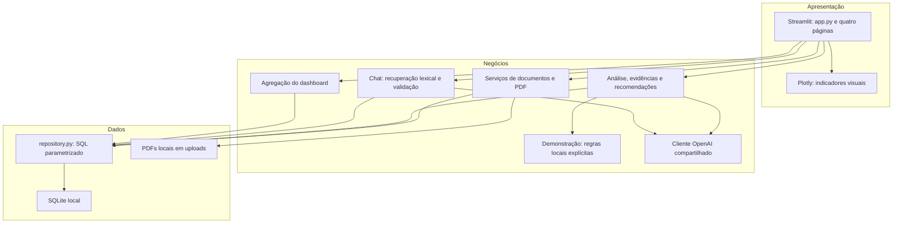

# Arquitetura do InsightFlow AI

## Três camadas em um monólito modular

A apresentação chama funções Python diretamente. Não há API REST interna, autenticação, microsserviços, filas ou frameworks de agentes. O módulo de demonstração pertence à camada de negócios; não é uma nova camada. O gerador de PDFs é um utilitário local que usa PyMuPDF e o conteúdo canônico do cenário fictício.

## Apresentação

`app.py` carrega configurações, inicializa o armazenamento e define as quatro páginas com `st.Page` e `st.navigation`. Esse mecanismo desativa a descoberta automática de `pages/`, evitando duplicação ([documentação Streamlit](https://docs.streamlit.io/develop/api-reference/navigation/st.navigation)). O tema usa recursos nativos e uma pequena personalização CSS do upload, sem JavaScript próprio.

Documentos oferece upload e texto por página. Análises oferece seleção explícita, histórico, filtros e evidências. Dashboard mostra indicadores e gráficos do modo atual. Assistente IA usa componentes de chat com histórico de sessão separado por modo. O aviso de demonstração aparece no cabeçalho, nas análises e no dashboard.

## Negócios

- `document_service.py`: valida upload, grava UUID, coordena extração e persistência, consulta biblioteca.
- `pdf_service.py`: extrai até dez páginas com PyMuPDF, preserva a numeração e fecha recursos.
- `analysis_service.py`: limita contexto, escolhe modo, orquestra as etapas, valida citações, salva e recupera resultados.
- `demo_service.py`: contém o cenário fictício e gera achados locais somente quando o texto corresponde aos exemplos originais.
- `llm_service.py`: usa o SDK oficial OpenAI e saídas estruturadas. Bloqueia qualquer chamada quando `demo_mode=True`.
- `dashboard_service.py`: agrega resultados do modo atual após reconferir evidências; não chama a IA.
- `chat_service.py`: recupera trechos por termos; no modo normal solicita uma resposta estruturada; na demonstração retorna apenas trechos locais identificados.

O cliente real usa `responses.parse(..., text_format=Schema)` e `output_parsed`, conforme a [documentação oficial](https://developers.openai.com/api/docs/guides/structured-outputs). Timeout de sessenta segundos, sem retentativas automáticas, limite de entrada/saída e `store=False`. Chave e modelo vêm da configuração. Apenas perguntas, trechos e fatos limitados são enviados; os PDFs não são enviados como arquivos.

## Dados e migração

`database/db.py` inicializa automaticamente o SQLite, ativa chaves estrangeiras por conexão e garante fechamento, commit e rollback. `repository.py` contém SQL parametrizado. PDFs ficam em `uploads/<uuid>.pdf`.

Tabelas: `app_metadata`, `documents`, `document_pages`, `analyses`, `analysis_documents`, `findings` e `finding_evidence`. A versão 4 acrescenta `analyses.is_demo`, mantendo os dados existentes. Análises antigas recebem `false`, pois antes da etapa 6 eram produzidas pelo fluxo real. A migração é idempotente.

Resultados simulados e reais compartilham as tabelas, mas as consultas do serviço e do dashboard filtram `is_demo` conforme o modo. A recuperação por ID também rejeita resultados de outro modo. A biblioteca de documentos é compartilhada e os exemplos são identificados como fictícios. Não há inserção automática de dados ao abrir a aplicação.

Cada análise é salva integralmente em uma transação. No upload, falhas normais removem o arquivo recém-criado e desfazem o banco. Uma interrupção abrupta pode deixar um arquivo órfão, pois sistema de arquivos e SQLite não compartilham uma transação única.

## Configuração e reutilização

`config.py` centraliza limites e caminhos com `pathlib`. Pydantic valida os valores e `SecretStr` representa a chave. Variáveis do processo prevalecem sobre `.env`. Sem configuração, o modo é normal; `.env.example` vem com demonstração ativada.

O cache de análises usa hash dos trechos, referências, avisos, modo, modelo e versão do fluxo. A demonstração usa o identificador `demo-local-v1`. Mesma entrada não gera nova análise ou chamada em reruns. Regras ou prompts alterados exigem atualizar a versão correspondente. Listas e dados persistidos não são duplicados em `st.session_state`; somente seleções, feedback e conversa transitória são mantidos.

Citações são conferidas por documento, nome, página e substring literal. A checagem é refeita ao consultar resultados. Isso valida a fonte, não a correção semântica da interpretação. Riscos continuam sendo possibilidades para revisão humana.

Veja [fluxo dos agentes](agent-flow.md), [processamento de documentos](document-processing.md), [chat](chat.md) e [demonstração](demo.md).
